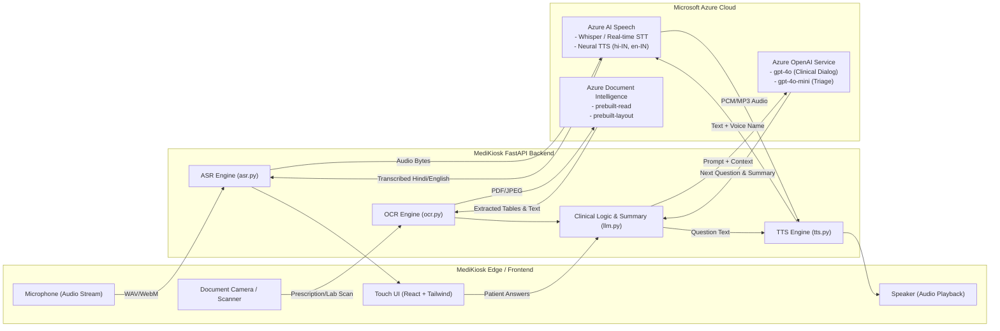

# Azure AI Services Provisioning Guide — MediKiosk (SIH 2026)

This is a step-by-step, zero-to-hero cloud provisioning manual for deploying Microsoft Azure AI services for the **MediKiosk** patient case-taking platform.

This guide assumes you have access to an Azure subscription (such as the **$4,000 Microsoft for Startups Founders Hub** credits) and covers exact portal navigation paths, button clicks, field values, model deployments, API key extraction, cost estimations, studio verifications, and troubleshooting.

---

## Table of Contents
1. [Architecture & Services Overview](#1-architecture--services-overview)
2. [Prerequisites & Resource Group Setup](#2-prerequisites--resource-group-setup)
3. [Provisioning 1: Azure OpenAI Service](#3-provisioning-1-azure-openai-service)
   - [3.1 Create the Azure OpenAI Resource](#31-create-the-azure-openai-resource)
   - [3.2 Deploy `gpt-4o` and `gpt-4o-mini` Models](#32-deploy-gpt-4o-and-gpt-4o-mini-models)
   - [3.3 Retrieve Endpoint and API Keys](#33-retrieve-endpoint-and-api-keys)
4. [Provisioning 2: Azure AI Speech Services](#4-provisioning-2-azure-ai-speech-services)
   - [4.1 Create the Speech Service Resource](#41-create-the-speech-service-resource)
   - [4.2 Retrieve Speech Key & Region](#42-retrieve-speech-key--region)
   - [4.3 Neural Voice Configurations (Hindi & Indian English)](#43-neural-voice-configurations-hindi--indian-english)
5. [Provisioning 3: Azure Document Intelligence (OCR)](#5-provisioning-3-azure-document-intelligence-ocr)
   - [5.1 Create the Document Intelligence Resource](#51-create-the-document-intelligence-resource)
   - [5.2 Retrieve Endpoint & API Key](#52-retrieve-endpoint--api-key)
   - [5.3 Prebuilt Models Overview (`prebuilt-read` & `prebuilt-layout`)](#53-prebuilt-models-overview-prebuilt-read--prebuilt-layout)
6. [Consolidated Environment Variables (`backend/.env`)](#6-consolidated-environment-variables-backendenv)
7. [Cost Estimation & $4,000 Credit Budget Plan](#7-cost-estimation--4000-credit-budget-plan)
   - [7.1 Monthly Cost Calculation (100 Patients/Day)](#71-monthly-cost-calculation-100-patientsday)
   - [7.2 Setting Up Budget Alerts in Azure](#72-setting-up-budget-alerts-in-azure)
8. [Quick Verification Guide (Interactive Studios & CLI)](#8-quick-verification-guide-interactive-studios--cli)
   - [8.1 Test Azure OpenAI in AI Foundry](#81-test-azure-openai-in-ai-foundry)
   - [8.2 Test Speech in Speech Studio](#82-test-speech-in-speech-studio)
   - [8.3 Test OCR in Document Intelligence Studio](#83-test-ocr-in-document-intelligence-studio)
   - [8.4 Quick Terminal Verification Commands](#84-quick-terminal-verification-commands)
9. [Troubleshooting & Common Errors](#9-troubleshooting--common-errors)

---

## 1. Architecture & Services Overview

MediKiosk integrates three core Azure AI services to deliver an autonomous, bilingual (Hindi/English) clinical intake experience:



| Service | Azure Resource Type | MediKiosk Feature | Primary Region |
|---|---|---|---|
| **Azure OpenAI** | `Microsoft.CognitiveServices/accounts` (OpenAI) | Dynamic clinical interview question generation, structured entity extraction, EMR clinical case summary synthesis | `Central India` / `East US` |
| **Azure AI Speech** | `Microsoft.CognitiveServices/accounts` (SpeechServices) | Real-time bilingual speech-to-text (STT) and empathetic neural speech synthesis (TTS) | `Central India` |
| **Azure Document Intelligence** | `Microsoft.CognitiveServices/accounts` (FormRecognizer) | High-accuracy OCR, printed prescription digitizing, lab report table extraction | `Central India` |

---

## 2. Prerequisites & Resource Group Setup

All Azure resources must belong to a single **Resource Group** to simplify access management, billing tracking, and teardown.

### Step 2.1: Log into the Azure Portal
1. Open your browser and navigate to: [https://portal.azure.com](https://portal.azure.com).
2. Sign in with the Microsoft account associated with your **Azure for Startups / Founders Hub** subscription.
3. In the top bar, ensure your directory is set to the tenant holding your credit sponsorship.

> [!TIP]
> To check your remaining credit balance at any time, navigate to **Cost Management + Billing** from the search bar.

---

### Step 2.2: Create a Dedicated Resource Group
1. In the top global search bar, type `Resource groups` and select **Resource groups** under Services.
2. In the top-left toolbar, click **+ Create**.

```
[UI Screenshot Simulation: Azure Portal - Create Resource Group]
┌────────────────────────────────────────────────────────────────────────┐
│ Home > Resource groups > Create a resource group                       │
├────────────────────────────────────────────────────────────────────────┤
│ Basics | Tags | Review + create                                        │
│                                                                        │
│ Project details                                                        │
│   Subscription     : [ Azure for Startups ($4000 Credit)          ▼ ]  │
│   Resource group   : [ rg-medikiosk-prod                            ]  │
│                                                                        │
│ Instance details                                                       │
│   Region           : [ (Asia Pacific) Central India               ▼ ]  │
│                                                                        │
│ [ Review + create ]  [ < Previous ]  [ Next: Tags > ]                  │
└────────────────────────────────────────────────────────────────────────┘
```

3. Fill out the **Basics** tab:
   - **Subscription**: Select your active Azure subscription (e.g. *Azure for Startups*).
   - **Resource group**: `rg-medikiosk-prod` (or `rg-medikiosk-dev`).
   - **Region**: `(Asia Pacific) Central India`.
4. Click **Review + create**, then click **Create**.
5. You will see a notification: `Resource group created successfully`.

---

## 3. Provisioning 1: Azure OpenAI Service

Azure OpenAI provides access to OpenAI's GPT-4o models with enterprise SLA, HIPAA/GDPR readiness, and private networking.

> [!IMPORTANT]
> **Access Requirement**: Azure OpenAI requires prior subscription registration. If you see a banner stating *"Azure OpenAI Service requires registration"*, submit the quick access request form at [https://aka.ms/oai/access](https://aka.ms/oai/access). Startup credit accounts are usually approved promptly.

---

### 3.1 Create the Azure OpenAI Resource

1. In the Azure Portal search bar, type `Azure OpenAI` and select **Azure OpenAI** under Azure AI Services.
2. Click **+ Create** (or **+ Create Azure OpenAI**).

```
[UI Screenshot Simulation: Create Azure OpenAI Resource]
┌────────────────────────────────────────────────────────────────────────┐
│ Home > Azure AI services > Azure OpenAI > Create Azure OpenAI          │
├────────────────────────────────────────────────────────────────────────┤
│ Basics | Network | Tags | Review + submit                              │
│                                                                        │
│ Project Details                                                        │
│   Subscription     : [ Azure for Startups                         ▼ ]  │
│   Resource group   : [ rg-medikiosk-prod                          ▼ ]  │
│                                                                        │
│ Instance Details                                                       │
│   Region           : [ Central India  (or East US)                ▼ ]  │
│   Name             : [ medikiosk-openai                             ]  │
│   Pricing tier     : [ Standard S0                                ▼ ]  │
│                                                                        │
│ [ Review + submit ]  [ < Previous ]  [ Next: Network > ]               │
└────────────────────────────────────────────────────────────────────────┘
```

3. Enter the following details:
   - **Subscription**: Your active credit subscription.
   - **Resource group**: `rg-medikiosk-prod`.
   - **Region**: Select **Central India** (or **East US** if quota is unavailable in India for your subscription).
   - **Name**: `medikiosk-openai` *(must be globally unique, letters and numbers only)*.
   - **Pricing tier**: **Standard S0** *(Default tier for Azure OpenAI)*.
4. Click **Next: Network** -> Select **All networks** (allows secure API access using API keys from any client).
5. Click **Review + submit**, wait for the validation check to pass, then click **Create**.
6. Deployment takes ~1–2 minutes. Once complete, click **Go to resource**.

---

### 3.2 Deploy `gpt-4o` and `gpt-4o-mini` Models

Models must be deployed inside your Azure OpenAI instance before the API can serve requests.

1. On your `medikiosk-openai` overview page, click the button **Go to Azure AI Foundry portal** (or **Go to Azure OpenAI Studio** / navigate to [https://ai.azure.com](https://ai.azure.com)).
2. In the left navigation menu of the Studio, click **Deployments** (under *Management* or *Shared resources*).
3. Click **+ Deploy model** -> **Deploy base model**.

```
[UI Screenshot Simulation: Azure AI Studio - Model Deployment Dialog]
┌────────────────────────────────────────────────────────────────────────┐
│ Deploy model gpt-4o                                                    │
├────────────────────────────────────────────────────────────────────────┤
│ Select a model:      [ gpt-4o (Omni multimodal model)              ▼ ] │
│ Model version:       [ 2024-05-13 (or latest default)              ▼ ] │
│ Deployment type:     [ Global Standard                             ▼ ] │
│ Deployment name:     [ gpt-4o                                        ] │
│ Tokens Per Minute:   [ ───●────────────────────── ] 50K TPM            │
│ Content Filter:      [ Default                                     ▼ ] │
│                                                                        │
│                           [ Cancel ]   [ Deploy ]                      │
└────────────────────────────────────────────────────────────────────────┘
```

#### Deployment 1: `gpt-4o` (Primary Clinical Engine)
- **Model**: `gpt-4o`
- **Model version**: `2024-05-13` (or `2024-08-06` / `latest default`)
- **Deployment type**: **Global Standard** (or **Standard**)
- **Deployment name**: `gpt-4o` *(Must match exactly; this is referenced in `backend/.env`)*
- **Tokens Per Minute (TPM) limit**: Set to `50K` or `80K` TPM (sufficient for kiosk use).
- Click **Deploy**.

#### Deployment 2: `gpt-4o-mini` (Fast Triage & Light Processing)
- Click **+ Deploy model** -> **Deploy base model**.
- **Model**: `gpt-4o-mini`
- **Model version**: `2024-07-18` (or `latest default`)
- **Deployment type**: **Global Standard** (or **Standard**)
- **Deployment name**: `gpt-4o-mini`
- **Tokens Per Minute (TPM) limit**: Set to `50K` TPM.
- Click **Deploy**.

> [!TIP]
> Naming the deployment identical to the model name (e.g. `gpt-4o`) ensures smooth compatibility across standard OpenAI SDK client configurations.

---

### 3.3 Retrieve Endpoint and API Keys

1. Return to the [Azure Portal](https://portal.azure.com).
2. Open your `rg-medikiosk-prod` resource group and click on `medikiosk-openai`.
3. In the left sidebar, under the **Resource Management** section, click **Keys and Endpoint**.

```
[UI Screenshot Simulation: Azure OpenAI Keys and Endpoint Blade]
┌────────────────────────────────────────────────────────────────────────┐
│ Home > rg-medikiosk-prod > medikiosk-openai > Keys and Endpoint        │
├────────────────────────────────────────────────────────────────────────┤
│ Manage your keys and find your service endpoint URL                    │
│                                                                        │
│ KEY 1          : [ 7a8b9c0d1e2f3a4b5c6d7e8f9a0b1c2d   ] [📋 Copy]      │
│ KEY 2          : [ 1f2e3d4c5b6a7f8e9d0c1b2a3f4e5d6c   ] [📋 Copy]      │
│ Endpoint       : [ https://medikiosk-openai.openai.azure.com/ ] [📋]    │
│ Location       : centralindia (or eastus)                              │
└────────────────────────────────────────────────────────────────────────┘
```

4. Click the **Copy** icon next to **KEY 1**.
5. Click the **Copy** icon next to **Endpoint**.
6. Map these to your environment variables:
   ```bash
   AZURE_OPENAI_ENDPOINT=https://medikiosk-openai.openai.azure.com/
   AZURE_OPENAI_API_KEY=7a8b9c0d1e2f3a4b5c6d7e8f9a0b1c2d
   AZURE_OPENAI_DEPLOYMENT=gpt-4o
   ```

   > **Either resource type works.** Paste the endpoint exactly as the portal
   > shows it. An **Azure OpenAI** resource gives you
   > `https://<name>.openai.azure.com`; a **Microsoft Foundry** resource gives
   > you `https://<name>.services.ai.azure.com`. MediKiosk normalizes both to
   > the `/openai/v1` base, so no code or config change is needed to switch.
   >
   > `AZURE_OPENAI_DEPLOYMENT` must be the **deployment** name you chose when
   > deploying the model, which is not always the same as the model name.

---

## 4. Provisioning 2: Azure AI Speech Services

Azure Speech Services powers the voice-driven kiosk interface with native Speech-to-Text (STT) and Neural Text-to-Speech (TTS) for Hindi (`hi-IN`) and Indian English (`en-IN`).

---

### 4.1 Create the Speech Service Resource

1. In the Azure Portal search bar, type `Speech` and select **Speech** (under *Azure AI Services*).
2. Click **+ Create** (or **+ Create Speech service**).

```
[UI Screenshot Simulation: Create Speech Service Resource]
┌────────────────────────────────────────────────────────────────────────┐
│ Home > Azure AI services > Speech > Create Speech                      │
├────────────────────────────────────────────────────────────────────────┤
│ Basics | Networking | Tags | Review + create                           │
│                                                                        │
│ Project Details                                                        │
│   Subscription     : [ Azure for Startups                         ▼ ]  │
│   Resource group   : [ rg-medikiosk-prod                          ▼ ]  │
│                                                                        │
│ Instance Details                                                       │
│   Region           : [ Central India                              ▼ ]  │
│   Name             : [ medikiosk-speech                             ]  │
│   Pricing tier     : [ Standard S0 (or Free F0)                   ▼ ]  │
│                                                                        │
│ [ Review + create ]  [ < Previous ]  [ Next: Networking > ]            │
└────────────────────────────────────────────────────────────────────────┘
```

3. Fill out the fields:
   - **Subscription**: Your Azure credit subscription.
   - **Resource group**: `rg-medikiosk-prod`.
   - **Region**: **Central India** (`centralindia`) — *Essential for ultra-low audio latency to kiosk hardware in India*.
   - **Name**: `medikiosk-speech`.
   - **Pricing tier**:
     - For initial local testing: **Free F0** (includes 5 hours of STT + 0.5M characters of Neural TTS per month).
     - For production/kiosk deployment: **Standard S0** (billed against your $4000 credits, unlimited concurrent requests).
4. Click **Review + create**, then click **Create**.
5. Once deployment finishes (~30 seconds), click **Go to resource**.

---

### 4.2 Retrieve Speech Key & Region

1. Inside the `medikiosk-speech` resource, look at the left sidebar under **Resource Management**.
2. Click **Keys and Endpoint**.
3. Copy **KEY 1** and note the **Location/Region** identifier (`centralindia`).

```bash
AZURE_SPEECH_KEY=4e5f6a7b8c9d0e1f2a3b4c5d6e7f8a9b
AZURE_SPEECH_REGION=centralindia
```

> [!WARNING]
> Do NOT copy the full endpoint URL for `AZURE_SPEECH_REGION`. Use the short lowercase location slug (e.g. `centralindia`, `eastus`, `centralus`).

---

### 4.3 Neural Voice Configurations (Hindi & Indian English)

Azure AI Speech includes natural neural voices with authentic Indian accents, natural medical inflection, and clear phonetic rendering:

| Language / Locale | Recommended Neural Voice Name | Gender | Intended Use Case in MediKiosk |
|---|---|---|---|
| **Hindi (India)** — `hi-IN` | `hi-IN-SwaraNeural` | Female | **Primary Hindi Voice** — warm, respectful, natural cadence for elderly and rural patients |
| **Hindi (India)** — `hi-IN` | `hi-IN-MadhurNeural` | Male | Alternative Hindi voice |
| **English (India)** — `en-IN` | `en-IN-NeerjaNeural` | Female | **Primary English Voice** — clear Indian English diction, medical term accuracy |
| **English (India)** — `en-IN` | `en-IN-PrabhatNeural` | Male | Alternative Indian English voice |

The backend automatically switches between `hi-IN-SwaraNeural` and `en-IN-NeerjaNeural` based on the active patient language setting.

---

## 5. Provisioning 3: Azure Document Intelligence (OCR)

Azure Document Intelligence (formerly Azure Form Recognizer) uses machine learning models to extract text, tables, checkboxes, and layout from patient prescriptions, doctor notes, and laboratory test reports.

---

### 5.1 Create the Document Intelligence Resource

1. In the Azure Portal top search bar, type `Document Intelligence` and select **Document Intelligence** under *Azure AI Services*.
2. Click **+ Create**.

```
[UI Screenshot Simulation: Create Document Intelligence Resource]
┌────────────────────────────────────────────────────────────────────────┐
│ Home > Azure AI services > Document Intelligence > Create              │
├────────────────────────────────────────────────────────────────────────┤
│ Basics | Networking | Tags | Review + create                           │
│                                                                        │
│ Project Details                                                        │
│   Subscription     : [ Azure for Startups                         ▼ ]  │
│   Resource group   : [ rg-medikiosk-prod                          ▼ ]  │
│                                                                        │
│ Instance Details                                                       │
│   Region           : [ Central India                              ▼ ]  │
│   Name             : [ medikiosk-doc-intelligence                   ]  │
│   Pricing tier     : [ Standard S0 (or Free F0)                   ▼ ]  │
│                                                                        │
│ [ Review + create ]  [ < Previous ]  [ Next: Networking > ]            │
└────────────────────────────────────────────────────────────────────────┘
```

3. Fill out the fields:
   - **Subscription**: Your Azure credit subscription.
   - **Resource group**: `rg-medikiosk-prod`.
   - **Region**: **Central India** (or `East US`).
   - **Name**: `medikiosk-doc-intelligence`.
   - **Pricing tier**:
     - Dev: **Free F0** (500 pages per month).
     - Production/Kiosk: **Standard S0** ($1.50 per 1,000 pages).
4. Click **Review + create**, then click **Create**.
5. Once deployment succeeds, click **Go to resource**.

---

### 5.2 Retrieve Endpoint & API Key

1. Inside `medikiosk-doc-intelligence`, select **Resource Management** -> **Keys and Endpoint**.
2. Copy **KEY 1** and the **Endpoint** URL.

```bash
AZURE_DOC_INTELLIGENCE_ENDPOINT=https://medikiosk-doc-intelligence.cognitiveservices.azure.com/
AZURE_DOC_INTELLIGENCE_KEY=3c2b1a0f9e8d7c6b5a4f3e2d1c0b9a8f
```

---

### 5.3 Prebuilt Models Overview (`prebuilt-read` & `prebuilt-layout`)

MediKiosk uses Azure Document Intelligence's **zero-shot prebuilt models** — no custom model training, labeling, or dataset gathering is required!

```
┌─────────────────────────────────────────────────────────────────────────┐
│                    MediKiosk OCR Processing Pipeline                    │
│                                                                         │
│   Patient Upload         Prebuilt Model              Extracted Data     │
│   ┌─────────────┐       ┌─────────────────┐        ┌─────────────────┐  │
│   │ Doctor Note │ ────> │  prebuilt-read  │ ─────> │ Handwritten &   │  │
│   │ Prescription│       │ (High Res OCR)  │        │ Printed Text    │  │
│   └─────────────┘       └─────────────────┘        └─────────────────┘  │
│                                                                         │
│   ┌─────────────┐       ┌─────────────────┐        ┌─────────────────┐  │
│   │ Lab Report  │ ────> │ prebuilt-layout │ ─────> │ Table Matrix    │  │
│   │ (CBC / Lipid│       │ (Tables/Key-Val)│        │ (Param/Val/Unit)│  │
│   └─────────────┘       └─────────────────┘        └─────────────────┘  │
└─────────────────────────────────────────────────────────────────────────┘
```

1. **`prebuilt-read` Model**:
   - Optimized for raw text extraction from printed and handwritten documents.
   - Handles low-light camera photos, skewed angles, rotated prescriptions, and mixed Hindi/English scripts.
   - Returns line-by-line bounding boxes and confidence scores.

2. **`prebuilt-layout` Model**:
   - Analyzes structure: detects tables, row/column boundaries, headers, key-value pairs, and checkboxes.
   - Essential for parsing structured diagnostic lab reports (e.g. Blood Glucose, Hemoglobin, Lipid Profile, Thyroid tests) directly into tabular JSON.

---

## 6. Consolidated Environment Variables (`backend/.env`)

Add the provisioned credentials to your local or server environment file at `/Users/aarsh/Codes/Medi-Kiosk/backend/.env`:

```ini
# ==============================================================================
# MediKiosk Backend — Azure AI Services Configuration
# ==============================================================================

# ── 1. Azure OpenAI Service ───────────────────────────────────────────────────
# Endpoint and Key from Azure Portal > medikiosk-openai > Keys and Endpoint
# A Foundry resource works too: https://medikiosk-openai.services.ai.azure.com/
# Either host is accepted; the app appends /openai/v1 itself.
AZURE_OPENAI_ENDPOINT=https://medikiosk-openai.openai.azure.com/
AZURE_OPENAI_API_KEY=your-azure-openai-key-1
AZURE_OPENAI_DEPLOYMENT=gpt-4o
# No AZURE_OPENAI_API_VERSION: the v1 API drops the dated api-version parameter,
# so there is nothing to keep bumping as versions retire.

# ── 2. Azure AI Speech Services ───────────────────────────────────────────────
# Key and Region from Azure Portal > medikiosk-speech > Keys and Endpoint
AZURE_SPEECH_KEY=your-azure-speech-key-1
AZURE_SPEECH_REGION=centralindia

# Primary Neural Voice selections
AZURE_SPEECH_VOICE_HI=hi-IN-SwaraNeural
AZURE_SPEECH_VOICE_EN=en-IN-NeerjaNeural

# Provider selection switches (enable Azure as primary engine)
ASR_PROVIDER=azure
TTS_PROVIDER=azure

# ── 3. Azure Document Intelligence ────────────────────────────────────────────
# Endpoint and Key from Azure Portal > medikiosk-doc-intelligence > Keys and Endpoint
AZURE_DOC_INTELLIGENCE_ENDPOINT=https://medikiosk-doc-intelligence.cognitiveservices.azure.com/
AZURE_DOC_INTELLIGENCE_KEY=your-azure-doc-intelligence-key-1

# OCR Provider switch
OCR_ENGINE=azure_doc_intelligence
```

### Applying Changes to the Running Container

Whenever you update `backend/.env`, restart the backend Docker container so changes take effect:

```bash
# 1. Navigate to infra directory
cd /Users/aarsh/Codes/Medi-Kiosk/infra

# 2. Restart backend container without rebuilding image
docker compose up -d --no-build backend

# 3. Verify that the Azure environment variables are loaded inside Docker
docker compose exec backend env | grep -E "AZURE|ASR_PROVIDER|TTS_PROVIDER|OCR_ENGINE"
```

---

## 7. Cost Estimation & $4,000 Credit Budget Plan

The team has **$4,000 in Azure startup credits**. Below is an itemized cost projection for dev, testing, and a real-world pilot of **100 patients per day** (3,000 patient encounters per month).

### 7.1 Monthly Cost Calculation (100 Patients/Day)

#### Assumptions:
- **Patients per month**: 3,000 patients.
- **Intake interview**: ~10 conversational turns per patient (~6,000 input tokens + ~1,500 output tokens total across context and case summary).
- **Audio duration**: ~3 minutes of spoken audio per patient (STT) + ~2,000 spoken characters by the kiosk (TTS).
- **Document uploads**: ~1.5 document pages per patient (prescriptions or lab reports) = 4,500 pages/month.

| Azure AI Service | Usage Unit & Rate | Monthly Consumption (3,000 Patients) | Estimated Cost (USD) | Estimated Cost (INR ₹) |
|---|---|---|---|---|
| **Azure OpenAI (GPT-4o)** | • Input: $2.50 / 1M tokens<br>• Output: $10.00 / 1M tokens | • 18M input tokens ($45.00)<br>• 4.5M output tokens ($45.00) | **$90.00 / month** | ~₹7,500 |
| **Azure OpenAI (GPT-4o-mini)** | • Input: $0.15 / 1M tokens<br>• Output: $0.60 / 1M tokens | • 5M input tokens ($0.75)<br>• 1M output tokens ($0.60) | **$1.35 / month** | ~₹110 |
| **Azure Speech (STT)** | Standard S0: $1.00 per audio hour | 150 total audio hours | **$150.00 / month** | ~₹12,450 |
| **Azure Speech (Neural TTS)** | Standard S0: $16.00 / 1M characters | 6.0M spoken characters | **$96.00 / month** | ~₹7,970 |
| **Azure Document Intelligence** | Standard S0: $1.50 per 1,000 pages (`prebuilt-read` & `layout`) | 4,500 uploaded document pages | **$6.75 / month** | ~₹560 |
| **Total Estimated Monthly Spend** | — | Full 3,000-Patient Live Kiosk Pilot | **~$344.10 / month** | **~₹28,590** |

#### Development & Testing Phase (Pre-Pilot):
During local development and hackathon testing (~100 mock sessions/month):
- Azure OpenAI: ~$2.50 / month
- Azure Speech: $0.00 *(fully covered under Free F0 tier)*
- Azure Document Intelligence: $0.00 *(fully covered under Free F0 tier)*
- **Total Dev Cost**: **< $5.00 / month**

> [!NOTE]
> **Credit Runway**: With $4,000 in startup credits, the team has sufficient funding for:
> - **11+ months** of full-scale live clinic pilot operations (100 patients/day).
> - **5+ years** of continuous development, feature additions, and hackathon demonstrations.

---

### 7.2 Setting Up Budget Alerts in Azure

Prevent accidental quota overages by creating automated email budget alerts:

1. In the Azure Portal search bar, type `Cost Management + Billing`.
2. In the left navigation menu, click **Budgets** (under *Cost Management*).
3. Click **+ Add**.
4. Configure Budget:
   - **Name**: `medikiosk-monthly-budget`
   - **Reset period**: `Monthly`
   - **Amount ($)**: `$200`
5. Configure Alerts:
   - Alert 1: **50% of budget** ($100) -> Send email to team leads.
   - Alert 2: **75% of budget** ($150) -> Send warning email.
   - Alert 3: **90% of budget** ($180) -> Immediate escalation.
6. Click **Create**.

---

## 8. Quick Verification Guide (Interactive Studios & CLI)

Verify all three Azure AI resources independently in your browser before running code.

### 8.1 Test Azure OpenAI in AI Foundry

1. Go to [https://ai.azure.com](https://ai.azure.com) or [https://oai.azure.com](https://oai.azure.com).
2. In the top bar, select your `medikiosk-openai` resource.
3. In the left menu under *Playgrounds*, click **Chat**.
4. In the **Deployment** dropdown, select `gpt-4o`.
5. In the **System message** box, paste:
   ```text
   You are MediKiosk, an empathetic bilingual clinical intake assistant for Indian primary healthcare centers. You interview patients in simple Hindi or English to collect their chief complaints, duration, and severity.
   ```
6. In the user chat input, test in Hindi:
   ```text
   मुझे 3 दिन से बहुत तेज बुखार और सिरदर्द है।
   ```
7. Verify that GPT-4o responds empathetically in clean Hindi, asking relevant clinical follow-up questions (e.g. chills, medication taken, thermometer reading).

---

### 8.2 Test Speech in Speech Studio

1. Open [https://speech.microsoft.com](https://speech.microsoft.com).
2. Click the gear icon (Settings) in the top-right -> Ensure your `medikiosk-speech` resource in `Central India` is selected.
3. **Test Text-to-Speech (TTS)**:
   - Click **Audio Content Creation** (or **Voice Gallery**).
   - Select Language: `Hindi (India)`.
   - Select Voice: `hi-IN-SwaraNeural`.
   - Enter text: `नमस्ते, मेडीकियोस्क में आपका स्वागत है। कृपया बताएं आपको क्या तकलीफ है?`
   - Click **Play** and verify natural cadence and clear audio.
4. **Test Speech-to-Text (STT)**:
   - In Speech Studio, click **Real-time Speech-to-text**.
   - Select Language: `Hindi (India) [hi-IN]`.
   - Click the **Microphone** icon, speak a clinical symptom in Hindi, and verify real-time transcribed text.

---

### 8.3 Test OCR in Document Intelligence Studio

1. Open [https://documentintelligence.ai.azure.com](https://documentintelligence.ai.azure.com) (or [https://formrecognizer.appliedai.azure.com](https://formrecognizer.appliedai.azure.com)).
2. Click **Settings** (top-right) -> Select your `medikiosk-doc-intelligence` resource.
3. **Test Prebuilt Read (Prescription OCR)**:
   - Click the **Read** tile.
   - Click **Browse for a file** and upload a sample doctor prescription (JPEG/PNG/PDF).
   - Click **Run analysis**.
   - Inspect the extracted text overlay, confidence scores, and raw JSON output.
4. **Test Prebuilt Layout (Lab Report Table Extraction)**:
   - Click the **Layout** tile.
   - Upload a sample Blood Test / CBC Report with tables.
   - Click **Run analysis**.
   - Verify that tables, column headers (*Test Name*, *Result*, *Reference Range*), and checkboxes are accurately recognized.

---

### 8.4 Quick Terminal Verification Commands

Run these copy-pasteable terminal commands to test your keys and endpoints directly:

#### Test 1: Verify Azure OpenAI Endpoint with `curl`

MediKiosk calls the **v1 API**, which is OpenAI-wire-compatible and needs no
dated `api-version` parameter. Test the same URL the app will use:

```bash
curl -X POST "https://medikiosk-openai.openai.azure.com/openai/v1/chat/completions" \
  -H "Content-Type: application/json" \
  -H "Authorization: Bearer $AZURE_OPENAI_API_KEY" \
  -d '{
    "model": "gpt-4o",
    "messages": [
      {"role": "system", "content": "You are MediKiosk AI."},
      {"role": "user", "content": "Respond with: Azure OpenAI is active!"}
    ],
    "max_tokens": 20
  }'
```
*Expected response*: HTTP 200 with `"content": "Azure OpenAI is active!"`.

Notes:
- `"model"` is your **deployment** name, not the base model name.
- If you provisioned a **Foundry** resource, swap the host for
  `https://<resource>.services.ai.azure.com` — the `/openai/v1` path is
  identical and the app handles both shapes.
- The older `/openai/deployments/<name>/chat/completions?api-version=...`
  surface still answers, but it ties you to a dated api-version that has to be
  bumped as versions retire. Prefer v1.

---

#### Test 2: Verify Azure Speech TTS with `curl`
```bash
curl -X POST "https://centralindia.tts.speech.microsoft.com/cognitiveservices/v1" \
  -H "Ocp-Apim-Subscription-Key: $AZURE_SPEECH_KEY" \
  -H "Content-Type: application/ssml+xml" \
  -H "X-Microsoft-OutputFormat: audio-16khz-128kbitrate-mono-mp3" \
  -d "<speak version='1.0' xml:lang='hi-IN'><voice xml:lang='hi-IN' name='hi-IN-SwaraNeural'>नमस्ते, मेडीकियोस्क चालू है।</voice></speak>" \
  --output test_speech.mp3

# Check file generated
ls -lh test_speech.mp3
```
*Expected response*: Generates a playable `test_speech.mp3` file containing synthesized Hindi speech.

---

#### Test 3: Verify Document Intelligence with `curl`
```bash
curl -X POST "https://medikiosk-doc-intelligence.cognitiveservices.azure.com/documentintelligence/documentModels/prebuilt-read:analyze?api-version=2024-02-29-preview" \
  -H "Ocp-Apim-Subscription-Key: $AZURE_DOC_INTELLIGENCE_KEY" \
  -H "Content-Type: application/json" \
  -d '{
    "urlSource": "https://raw.githubusercontent.com/Azure-Samples/cognitive-services-REST-api-samples/master/curl/form-recognizer/sample-layout.pdf"
  }' \
  -i
```
*Expected response*: HTTP 202 Accepted with an `Operation-Location` header.

---

## 9. Troubleshooting & Common Errors

| Error Code / Message | Root Cause | Exact Solution |
|---|---|---|
| `401 Access Denied` / `InvalidApiKey` | • Wrong key copied<br>• Trailing spaces in `.env`<br>• Primary key was rotated | 1. Check `backend/.env` for trailing whitespace or quotes.<br>2. Re-copy **KEY 1** from **Keys and Endpoint** in the Azure Portal.<br>3. Restart Docker container: `docker compose up -d --no-build backend`. |
| `404 Resource Not Found` / `DeploymentNotFound` | • Deployment name mismatch<br>• Model not deployed yet | 1. Go to [https://ai.azure.com](https://ai.azure.com) -> **Deployments**.<br>2. Confirm the deployment name matches `AZURE_OPENAI_DEPLOYMENT` exactly (`gpt-4o` vs `gpt-4o-2024-05-13`). |
| `Resource not approved for Azure OpenAI` | Subscription has not applied for Azure OpenAI access | Visit [https://aka.ms/oai/access](https://aka.ms/oai/access), fill out the company/startup details, and select your subscription ID. Approval typically takes 1 business day. |
| `429 Too Many Requests` / `RateLimitReached` | Model TPM (Tokens Per Minute) limit reached | 1. Go to Azure AI Studio -> Deployments -> Click `gpt-4o`.<br>2. Click **Edit Deployment**.<br>3. Increase TPM slider (e.g. from 10K to 80K TPM). |
| `Region Mismatch` / `Connection Timeout` | `AZURE_SPEECH_REGION` does not match the actual resource region | If your speech resource is in Central India, set `AZURE_SPEECH_REGION=centralindia` (all lowercase, no spaces). If in East US, set `AZURE_SPEECH_REGION=eastus`. |
| `Container still using old env variables` | Docker cached environment variables | Docker does not reload `.env` on file edit. Always run:<br>`docker compose up -d --no-build backend`<br>Then verify with: `docker compose exec backend env \| grep AZURE` |
| `ModelNotAvailableInRegion` during deployment | `gpt-4o` not available in chosen region | If Central India does not show `gpt-4o` in the model catalog for your tier, create an Azure OpenAI resource in **East US** or **Sweden Central**, which receive the latest frontier model versions first. |

---

## Summary Checklist for Developers

- [ ] Azure Resource Group `rg-medikiosk-prod` created in `Central India`.
- [ ] Azure OpenAI resource created with `gpt-4o` and `gpt-4o-mini` deployments.
- [ ] Azure Speech Services created in `Central India` (keys + region noted).
- [ ] Azure Document Intelligence created with `prebuilt-read` and `prebuilt-layout` access.
- [ ] Credentials populated in `/Users/aarsh/Codes/Medi-Kiosk/backend/.env`.
- [ ] Docker container restarted and verified with `docker compose exec backend env`.
- [ ] Chat, Speech, and OCR verified in Azure Studio playgrounds.
- [ ] Budget alert configured for credit protection.
