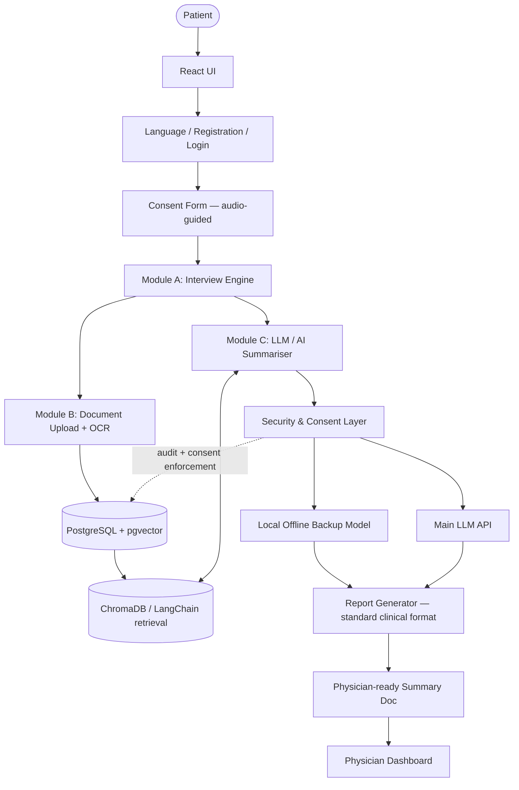

# Architecture

This is the system architecture translated from our whiteboard sketch. Treat the component
names/DB choices as the current decision, not gospel — log any change as an ADR at the bottom
of this file so we don't lose the "why" later.

## Component overview

| Component | Role |
|---|---|
| **UI** | React app — the patient-facing kiosk interface |
| **Lang / Reg / Login** | Language picker, ABHA/Aadhaar or new-patient registration, session login |
| **Consent form** | Audio-guided, granular consent capture — gates entry to the interview |
| **Interview** | Module A — the adaptive voice+touch history-taking engine |
| **Doc (upload)** | Module B — document scan/upload + OCR intake |
| **DB — pgsql + pgvector** | Primary relational store; `pgvector` extension holds embeddings for retrieval |
| **ChromaDB / LangChain** | Retrieval/orchestration layer sitting in front of (or alongside) pgvector for the AI summarizer's RAG needs |
| **LLM / AI Summariser** | Module C — merges interview + document data into the structured summary |
| **Security layer** | Enforces consent scope, encryption, access control before any AI call or data write |
| **Local (offline backup)** | On-device/on-prem fallback model — keeps the kiosk usable when connectivity or the main API is down |
| **API (main)** | Primary hosted LLM API — default path when available |
| **Report** | Formats the summariser's output into the standard clinical structure |
| **Doc (output)** | The finalized, physician-ready summary document |
| **Dashboard** | Physician-facing view: queue, summary, edit/confirm, document timeline |

## Data flow

## Why the dual local/API path for the LLM

Government OPDs can have unreliable connectivity, and this is health data, so we don't want a
single point of failure or a mandatory cloud round-trip for every patient. The Security Layer
decides, per request, whether to call the **Main API** (better quality, needs connectivity) or
fall back to the **Local model** (lower quality but works offline) — this should be a config
flag / automatic failover, not a hardcoded choice. Document this decision logic explicitly once
built, since it directly affects summary quality and is worth calling out in the demo.

## Why Postgres+pgvector *and* ChromaDB/LangChain

`pgvector` keeps embeddings co-located with the relational patient/document data (simpler ops,
one DB to back up/secure). LangChain (optionally with Chroma) sits on top as the retrieval/
orchestration layer the summariser actually talks to. If this turns out to be redundant for
the hackathon timeline, it's fine to go **pgvector-only** for the MVP and treat
Chroma/LangChain as a post-MVP optimization — flag this as an open decision (see below).

## Open decisions / ADR log

Add an entry each time an architecture decision is made or changed.

- **[Open]** pgvector-only vs. pgvector + separate Chroma store — decide once we know real
  document volume and query patterns.
- **[Open]** Which ASR/OCR vendors for the demo (see [`02-tech-stack.md`](./02-tech-stack.md))
  vs. AI4Bharat/Bhashini for the "real" post-hackathon build.
- **[Open]** Exact scope of the "Local offline backup" model — a small open-weight LLM via
  Ollama, or a rules-based fallback for the demo, with the real local model as future work.
